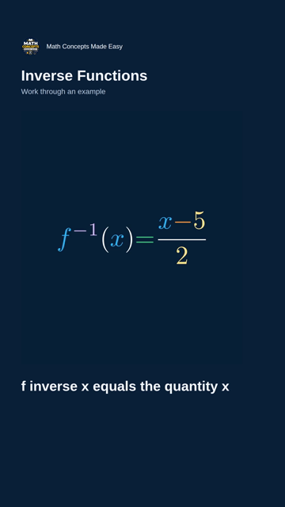

# Native portrait production

The daily workflow uses `autopilot.py --hybrid`: original landscape Manim
scenes go through the verified Remotion bridge for the full lesson, and a
separate `NativeShort` composition produces the three Shorts.

Shorts never read a landscape MP4. Each uses newly rendered 840 × 960 portrait
Manim teaching boards inside a 1080 × 1920 composition at 30 FPS. The original
channel logo appears once, at top left. Equations retain TeX fraction and
inverse notation and the shared semantic palette. Complete curriculum
statements and worked steps receive dedicated narration with real word
boundaries. Captions occupy their own lane below the teaching board.

The usable horizontal region is x=80…920. The board is y=420…1380; captions
are y=1430…1630. The right interaction rail and bottom 290 pixels remain
clear. Actual Manim object bounds are checked before rendering; narrow text
wraps without ellipses. Equations that cannot remain readable stop the run
for editorial review. Complete Shorts are limited to 180 seconds and never
cut off at an arbitrary time. The production gate requires final hashes to
match native-render receipts. Speech samples are compared with each original
page track and each full-lesson chapter, using one playback channel to avoid
stereo downmix false positives.

The sole daily scheduler starts generation at 06:00 America/New_York, with
DST-aware releases at 09:00 for the full lesson and 12:00, 18:00, and 22:00
for the three Shorts. A manual first-day kickoff can schedule the main
lesson 30 minutes after upload if 09:00 has passed. Otherwise missed release
slots move to the next local day; uploads do not silently become immediate
public posts. These are target times: generation, GitHub queue delays and
YouTube processing can delay availability.

`state/upload_ledger.json` records each asset's upload intent before insertion
and its returned YouTube ID immediately afterward. Production pushes these
checkpoints before proceeding. Retries reuse completed IDs; a lost response
stops for reconciliation rather than risking a duplicate upload. The uploader
checks actual YouTube privacy and publication timestamps before advancing
the lesson counter. An uncertain receipt must be reconciled with the channel
before it is changed. The recovery workflow requires the same native proof.

Preflight: `Native portrait Shorts verification` renders all three real Day 43
Shorts without publishing, retains full videos, original audio, word timings,
and a phone-size frame for every teaching page. A successful preflight and
review precede production activation. Past uploaded days remain locked.

## Verified rollout evidence — October 23, 2026

- PR #31 merged the native portrait composition and guarded hybrid publisher.
- Native render run [39942480443](https://github.com/mukundacity-glitch/Math-Concepts-Made-Easy/actions/runs/39942480443)
  passed on commit `58b4bac379102c05bcb81989f0eca8866d40aa7d`.
  Its three real Shorts contain 471, 592 and 615 frames (15.7, 19.733 and
  20.5 seconds). All ten teaching pages were reviewed at 360 × 640; all
  ten narration samples and source hashes passed verification.
- [Reviewed native video and phone frames](https://github.com/mukundacity-glitch/Math-Concepts-Made-Easy/actions/runs/39942480443/artifacts/12496457743).
- PR #32 preserves grouping in full-lesson inline fractions and complete
  numeric exponents. The real Manim fraction proof and 25 narrated premium
  solutions passed [run 39944372864](https://github.com/mukundacity-glitch/Math-Concepts-Made-Easy/actions/runs/39944372864).
  Local verification passed 173 Python tests, 31 Remotion tests, TypeScript
  compilation and bundling; all 1,071 curriculum mathematical display/speech
  inputs translated successfully.

The initial Day 43 kickoff was cancelled during dependency installation,
before any YouTube upload, to include the fraction correction. Day 43 remains
the first eligible production lesson at rollout; prior uploads 1–42 stay locked.

## First production release

[Daily production run 39945270854](https://github.com/mukundacity-glitch/Math-Concepts-Made-Easy/actions/runs/39945270854)
completed successfully in 22 minutes 34 seconds on source commit
`b2c8bb57832ee01e83716c15a9a0e9f060b51461`. YouTube returned and confirmed
the following publication times for **October 23, 2026, America/New_York**:

| Asset | Local release | YouTube |
| --- | --- | --- |
| Full lesson | 09:00 | https://youtu.be/w9H3JqcjLdw |
| Concept Short | 12:00 | https://youtu.be/P6CVAsf4CNI |
| Worked-example Short | 18:00 | https://youtu.be/SNESsYY3etw |
| Mistake Short | 22:00 | https://youtu.be/qJr9GbMUPIY |

The actual full export is 1920 × 1080 at 30 FPS, with 8,932 video frames.
The three actual Shorts are 1080 × 1920 at 30 FPS, with 471, 592 and 615 frames.
All nine full-lesson narration checks and ten native-page narration checks
passed. Final source receipts matched all three published Short files. All
ten portrait teaching pages were reviewed at 360 × 640; the full lesson was
visually sampled in all nine chapters. This was sampled verification, not a
frame-by-frame watch of the complete lesson.

Progress advanced to Day 44 only after YouTube confirmed all four schedules;
lessons 1–42 remain preserved. The daily scheduler remains enabled.

