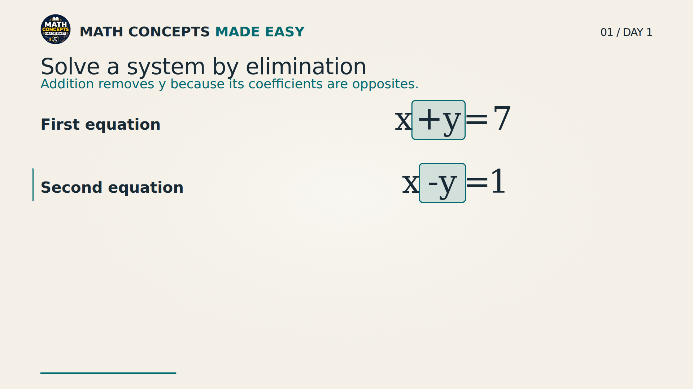
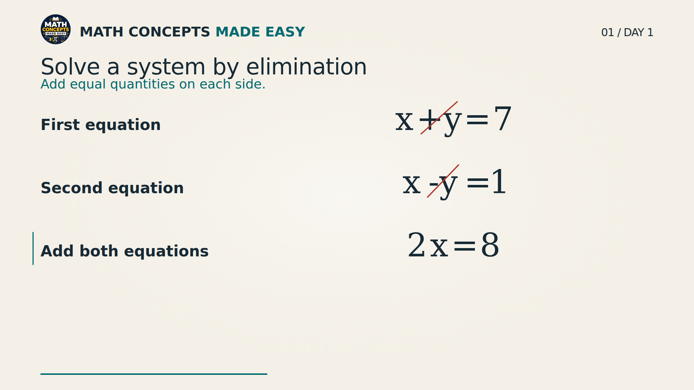
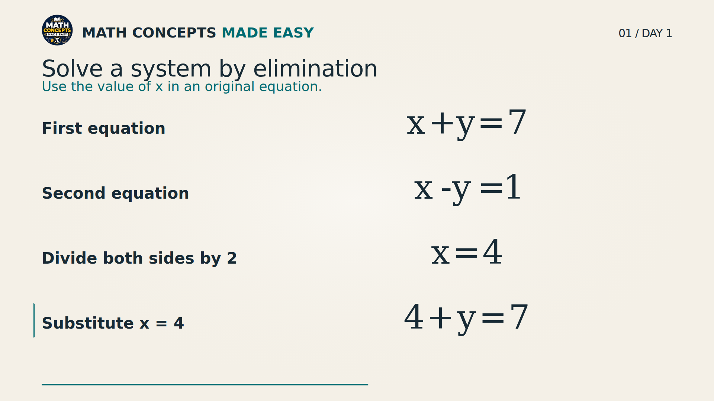
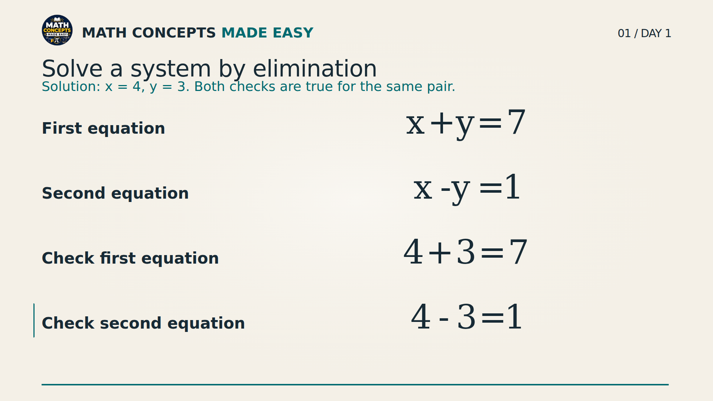

# Progressive elimination example

The earlier cinematic work is already on `main` through merged PR #33
(`e1f4c6a`). This change extends that renderer; it does not replace the inverse
lesson or introduce another video pipeline. No AGENTS.md exists in this checkout.

The default scheduled route is `daily-video.yml` → `autopilot.py --cinematic` →
`pipeline.cinematic_lesson` → `build_cinematic_plan` → measured Ryan narration →
`CinematicLesson` → `MathBoard`. This example enters the same compiler and uses
the same narration preparation, speech cues, composition, typography and board.
It is opt-in and does not enter the curriculum or upload queue.

## Authoring and checks

`examples/elimination_lesson.json` is the authoring source. Each beat specifies
purpose, narration, operation/reason, source/result IDs, highlighted semantic
terms, cue phrase, reading pause and retained rows. `{result}` expands from the
result's mathematical tokens, using the existing token-to-speech vocabulary.
The compiler generates the token cues from that same expansion. The final
solution label comes from the independently checked interpretation values.

The bounded affine parser supports exact rational arithmetic in x and y. It
checks both sides separately for addition, nonzero division, subtraction and
substitution. A substituted value needs an earlier solved-variable equation as
evidence. Both original equations must pass numeric checks before interpretation.
Opposite-term cancellation is checked across the two source equations on the
same side. Unsupported operations and nonlinear expressions fail closed.
This is a linear-system contract, not a validator for arbitrary mathematics.

MathBoard's existing rolling layout remains the default. Explicit board states
are optional: the example pins the two originals and retains up to two working
rows. Paired highlight windows precede cancellation; temporary cancellation marks
clear before the next operation so the original problem remains intact. The
six-second student pause occurs before either verification answer appears.

## Run without exporting

From the repository root, install project Python dependencies and run:

```bash
python -m pytest -q
python -m pipeline.cinematic_lesson --worked-example examples/elimination_lesson.json --preview-only
cd remotion
npm install
npm run check
npm run studio -- --props=build/worked-example/preview.json
```

Choose `EliminationWorkedExample`. The checked-in default is explicitly labeled
**SILENT PREVIEW · ESTIMATED TIMING**. To regenerate that default after authoring:

```bash
# From the repository root, after --preview-only above:
cp remotion/build/worked-example/preview.json remotion/src/cinematic/elimination-preview.json
```

For measured, audible timing, use the existing approved Ryan setup (Edge-TTS
7.2.8 and FFmpeg), then open Studio with the prepared props:

```bash
# Repository root:
python -m pipeline.cinematic_lesson --worked-example examples/elimination_lesson.json --prepare-only
cd remotion
npm run studio -- --props=build/worked-example/lesson.json
node scripts-worked-review.mjs
```

Preparation writes narration, measured word boundaries, hashes, frame durations,
`lesson.json` and optional `lesson.srt` / `lesson.vtt` sidecars. It does not render
MP4. Prepared audio lives under `public/cinematic/day-001/worked-example/`, apart
from scheduled lesson audio. Narrated renders reject missing real boundaries;
the silent preview never substitutes estimated timing for a prepared soundtrack.

The still-review command reuses one bundle/browser, validates all board cues and
writes method, cancellation, substitution and final-verification PNGs plus a
report under `remotion/build/worked-example/review/`. It creates no MP4.

## Review evidence and limits

All 12 Ryan clips were generated with actual word events and normalized by the
existing mastering code. Prepared duration is approximately 117 seconds,
including pauses. The exact duration, checkpoint frames and source hashes are
recorded in `docs/assets/elimination/report.json`. Four full-size frames were
rendered from the measured narration props and visually reviewed. The final
verification frame includes the solution pair and both original checks.

No final encoded video was requested or exported, so final AAC soundtrack
integrity and continuous video playback have not been verified. Automated math
and geometry tests do not prove teaching quality. Studio starts in this execution
environment, but the connected browser cannot reach its localhost server. The
portable player below removes that dependency. No production workflow,
publishing action, curriculum, upload ledger or lesson progress was changed.







## Portable player (localhost-independent)

After narration preparation, run from `remotion/`:

```bash
npm run preview:worked
npm run test:preview
```

Open `build/worked-example/elimination-preview.html` directly in a browser.
It is a single file with the existing `CinematicLesson`, Remotion Player,
logo and all 12 narration clips embedded. It provides play/pause, scrubbing,
volume/fullscreen controls and four checkpoint buttons. It does not start a
server, contact an external host, generate MP4 or publish anything.

The build verifies each prepared PCM source hash and all speech cues before
packaging. Preview-only Opus audio derivatives keep the same word/frame timeline;
the production renderer continues to use the original PCM assets and
`@remotion/media`. The portable bundle uses Remotion's native Audio player to
avoid external decoder/worker requests. The React asset context is empty in
production and is supplied only by the portable preview wrapper.

Real browser smoke testing opened the single file with no server, exercised all
four checkpoints, verified paired highlights and final verification text, played
embedded narration, and checked for overflow at 1100px and 360px. No browser
errors occurred. Evidence is in `docs/assets/elimination/portable-preview-smoke.json`.
This verifies preview playback; it is not a final MP4 soundtrack-integrity check.
